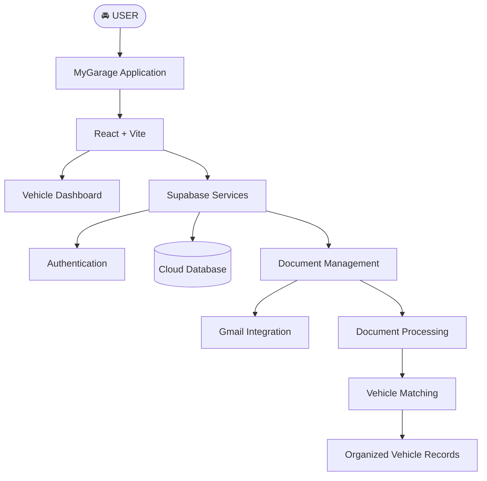

<!--
  MYGARAGE — PREMIUM GITHUB README
  Design: Midnight Automotive / Electric Blue
-->

  

  

  
  
  

  <strong>Not just a place to store vehicle details. A smarter way to manage ownership.</strong>

---

## ◈ THE EXPERIENCE

MyGarage is a centralized vehicle management platform built to simplify the responsibilities that come with owning vehicles.

From managing multiple vehicles to organizing important documents and discovering vehicle-related PDFs through Gmail, MyGarage brings essential ownership information into one connected experience.

 

## ▣ THE BENTO GRID

<table>
<tr>
<td colspan="2" width="65%" valign="top">

### 🚘 01 / YOUR VEHICLE HUB

**Everything starts here.**

A centralized dashboard to manage multiple vehicles, organize vehicle information and keep your garage accessible from one place.

</td>
<td width="35%" valign="top">

### ☁️ 02 / CLOUD CORE

**Connected by design.**

Supabase-powered authentication and cloud database integration.

</td>
</tr>
<tr>
<td width="33%" valign="top">

### 📄 03 / DOCUMENT INTELLIGENCE

Organize insurance, PUC and other vehicle documents.

- Document categorization
- Vehicle matching
- Duplicate detection
- Version history

</td>
<td width="33%" valign="top">

### 📧 04 / GMAIL INTEGRATION

Discover PDF attachments from Gmail and identify potentially relevant vehicle documents for review.

</td>
<td width="34%" valign="top">

### 🔔 05 / RENEWAL AWARENESS

Track document expiration dates and develop a more proactive renewal workflow.

</td>
</tr>
<tr>
<td colspan="3" valign="top">

### 📱 06 / BEYOND THE BROWSER

Built as a web application with an Android APK build, bringing the MyGarage experience towards mobile accessibility.

</td>
</tr>
</table>

---

## ⚡ ENGINEERED WITH

  

<table>
<tr>
<td width="50%" valign="top">

**FRONTEND**

- React.js
- Vite
- JavaScript
- CSS

</td>
<td width="50%" valign="top">

**BACKEND & INFRASTRUCTURE**

- Supabase
- Supabase Auth
- Cloud Database
- Cloudflare

</td>
</tr>
</table>

---

## ◈ SYSTEM ARCHITECTURE

---

## ◈ THE DEVELOPMENT ROADMAP

<strong>01 — CORE FOUNDATION</strong> &nbsp; <code>COMPLETED</code>

- [x] React + Vite application
- [x] Supabase authentication
- [x] Cloud database integration
- [x] Multiple vehicle management
- [x] Initial Cloudflare deployment
- [x] Android APK generation

<strong>02 — DOCUMENT MANAGEMENT</strong> &nbsp; <code>IN PROGRESS</code>

- [x] Document categorization
- [x] Vehicle matching
- [x] Duplicate detection
- [x] Document version history
- [ ] Complete automated document processing
- [ ] Improve Gmail attachment processing
- [ ] Enhanced document information extraction

<strong>03 — INTELLIGENT AUTOMATION</strong> &nbsp; <code>PLANNED</code>

- [ ] Automated expiry notifications
- [ ] Maintenance tracking
- [ ] Proactive renewal reminders
- [ ] Enhanced mobile experience
- [ ] Intelligent vehicle insights

---

## ◈ THE VISION

The future of MyGarage is an intelligent vehicle ownership ecosystem.

A platform that moves beyond manual record-keeping towards proactive management, automated document organization and connected vehicle information.

**One garage. Every vehicle. Complete visibility.**

---

## ◈ BUILT BY

  
    
  

  <i>Designed around a simple idea: vehicle ownership should be easier to manage.</i>

  

