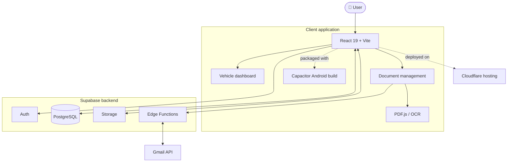

<div align="center">



<br />

**[Features](#core-features)** &nbsp;·&nbsp; **[Stack](#tech-stack)** &nbsp;·&nbsp; **[Architecture](#architecture)** &nbsp;·&nbsp; **[Progress](#progress)** &nbsp;·&nbsp; **[Run locally](#run-locally)** &nbsp;·&nbsp; **[Contact](#get-in-touch)**

<br />


<br />

<a href="#core-features"></a>
&nbsp;
<a href="https://github.com/AlwinJCOde667/MyGarage"></a>

<br /><br />


</div>

<br />

<p align="center"><b>One place to manage vehicles, organize documents and simplify the responsibilities of ownership.</b></p>

<p align="center">MyGarage is a multi-vehicle management app that brings vehicle details and ownership documents into one connected workspace, from the database to the app people actually use.</p>

---

<p><sub><b>01 &nbsp;/&nbsp; WORK</b></sub></p>

## Core features

<table>
  <tr>
    <td width="33%" valign="top">
      <h3>🚘 Multi-vehicle garage</h3>
      <p>A central dashboard for every vehicle you own. Records belong to the user's garage, not to one hardcoded vehicle.</p>
      <code>Dashboard</code> <code>Multi-vehicle</code> <code>React</code>
      <br /><br />
      <sub><b>STATUS</b> &nbsp;·&nbsp; Live</sub>
    </td>
    <td width="33%" valign="top">
      <h3>📄 Document management</h3>
      <p>Categorization, vehicle matching, duplicate detection and full version history for every document.</p>
      <code>Categories</code> <code>Matching</code> <code>Versions</code>
      <br /><br />
      <sub><b>STATUS</b> &nbsp;·&nbsp; Being improved</sub>
    </td>
    <td width="34%" valign="top">
      <h3>📧 Gmail workflow</h3>
      <p>Connect Gmail with your permission, discover PDF attachments that may be vehicle documents, then review and process them.</p>
      <code>Gmail API</code> <code>OAuth 2.0</code> <code>Edge Functions</code>
      <br /><br />
      <sub><b>STATUS</b> &nbsp;·&nbsp; Being improved</sub>
    </td>
  </tr>
  <tr>
    <td width="33%" valign="top">
      <h3>🔎 PDF processing</h3>
      <p>Text extraction from supported PDFs, with an OCR fallback for scanned files, to help classify documents and match vehicles.</p>
      <code>PDF.js</code> <code>OCR</code> <code>Classification</code>
      <br /><br />
      <sub><b>STATUS</b> &nbsp;·&nbsp; Being improved</sub>
    </td>
    <td width="33%" valign="top">
      <h3>📱 Web + Android</h3>
      <p>Built with React and Vite, then packaged for Android with Capacitor. An APK has been generated and tested.</p>
      <code>Capacitor 8</code> <code>Android</code> <code>Vite 8</code>
      <br /><br />
      <sub><b>STATUS</b> &nbsp;·&nbsp; Live</sub>
    </td>
    <td width="34%" valign="top">
      <h3>🔐 Secure by design</h3>
      <p>Explicit user consent for Gmail, and OAuth credentials and protected operations handled server-side, never in the client.</p>
      <code>Supabase Auth</code> <code>Storage</code> <code>PostgreSQL</code>
      <br /><br />
      <sub><b>STATUS</b> &nbsp;·&nbsp; Live</sub>
    </td>
  </tr>
</table>

---

<p><sub><b>02 &nbsp;/&nbsp; SKILLS</b></sub></p>

## Tech stack

<table>
  <tr>
    <td colspan="2" width="60%" valign="top">
      <sub><b>FRONTEND &amp; MOBILE</b></sub>
      <h3>One React codebase, two platforms</h3>
      
      <br /><br />
      
      
      
      
      
      
    </td>
    <td width="40%" valign="top">
      <sub><b>BACKEND &amp; DATABASE</b></sub>
      <h3>Supabase end to end</h3>
      
      <br /><br />
      
      
      
      
      
      
    </td>
  </tr>
  <tr>
    <td width="33%" valign="top">
      <sub><b>INTEGRATIONS</b></sub>
      <h3>Gmail + documents</h3>
      
      
      
      
    </td>
    <td width="33%" valign="top">
      <sub><b>HOSTING</b></sub>
      <h3>Deployed on the edge</h3>
      
      <br /><br />
      
      
    </td>
    <td width="34%" valign="top">
      <sub><b>DEV TOOLING</b></sub>
      <h3>Everyday workflow</h3>
      
      <br /><br />
      
      
      
      
      
    </td>
  </tr>
</table>

---

<p><sub><b>03 &nbsp;/&nbsp; SYSTEM</b></sub></p>

## Architecture



### How a document flows through

<table>
  <tr>
    <td align="center" width="16%"><h3>01</h3><b>Connect</b><br /><sub>Authorize Gmail</sub></td>
    <td align="center" width="16%"><h3>02</h3><b>Discover</b><br /><sub>Find PDF attachments</sub></td>
    <td align="center" width="17%"><h3>03</h3><b>Retrieve</b><br /><sub>Via protected function</sub></td>
    <td align="center" width="17%"><h3>04</h3><b>Extract</b><br /><sub>PDF text + OCR</sub></td>
    <td align="center" width="17%"><h3>05</h3><b>Classify</b><br /><sub>Type + vehicle match</sub></td>
    <td align="center" width="17%"><h3>06</h3><b>Review</b><br /><sub>Manage the record</sub></td>
  </tr>
</table>

---

<p><sub><b>04 &nbsp;/&nbsp; EXPERIENCE</b></sub></p>

## Progress

<details open>
<summary><b>Application foundation</b> &nbsp;</summary>
<br />

- [x] React + Vite application
- [x] Supabase authentication
- [x] Cloud database integration
- [x] Multi-vehicle management
- [x] Cloudflare deployment
- [x] Android APK generation and testing

</details>

<details open>
<summary><b>Document management</b> &nbsp;</summary>
<br />

- [x] Document categorization
- [x] Vehicle matching
- [x] Duplicate detection
- [x] Document version history
- [x] Gmail account integration
- [x] PDF attachment discovery and retrieval
- [x] PDF text extraction
- [ ] Improve reliability across PDF formats and attachment sizes
- [ ] Complete and harden automated document processing
- [ ] Improve extraction and classification accuracy

</details>

<details>
<summary><b>Ownership automation</b> &nbsp;</summary>
<br />

- [ ] Document-expiry notifications
- [ ] Insurance and PUC renewal reminders
- [ ] Maintenance and service tracking
- [ ] Next-service reminders
- [ ] Expanded mobile experience
- [ ] Intelligent vehicle insights

</details>

### What's next

<table>
  <tr>
    <td width="20%" valign="top"><h3>🧠</h3><b>Document intelligence</b><br /><sub>Better extraction, classification and vehicle matching</sub></td>
    <td width="20%" valign="top"><h3>🔔</h3><b>Renewals</b><br /><sub>Expiry dates, reminders and notification delivery</sub></td>
    <td width="20%" valign="top"><h3>🔧</h3><b>Maintenance</b><br /><sub>Service history, costs and next-service tracking</sub></td>
    <td width="20%" valign="top"><h3>📱</h3><b>Mobile</b><br /><sub>A smoother Android experience</sub></td>
    <td width="20%" valign="top"><h3>📊</h3><b>Insights</b><br /><sub>Useful summaries across all your vehicles</sub></td>
  </tr>
</table>

---

<p><sub><b>05 &nbsp;/&nbsp; ABOUT</b></sub></p>

## Engineering principles

<table>
  <tr>
    <td width="50%" valign="top"><b>Multi-vehicle first</b><br /><sub>Features work across a user's whole garage.</sub></td>
    <td width="50%" valign="top"><b>Reliable documents</b><br /><sub>PDFs vary in quality, so extraction is validated and fails gracefully.</sub></td>
  </tr>
  <tr>
    <td width="50%" valign="top"><b>Secure integrations</b><br /><sub>Explicit user consent for Gmail and protected handling of OAuth credentials.</sub></td>
    <td width="50%" valign="top"><b>Incremental delivery</b><br /><sub>Finished foundations are clearly separated from work in progress.</sub></td>
  </tr>
</table>

---

<p><sub><b>06 &nbsp;/&nbsp; DEVELOPERS</b></sub></p>

## Run locally

**Prerequisites:** Node.js and npm, Git, and a Supabase project with the required environment configuration.

```bash
# Clone the repository
git clone https://github.com/AlwinJCOde667/MyGarage.git
cd MyGarage

# Install dependencies and start the dev server
npm install
npm run dev
```

| Script | What it does |
|---|---|
| `npm run dev` | Start the Vite development server |
| `npm run build` | Create a production build |
| `npm run preview` | Preview the production build |
| `npm run lint` | Run ESLint |

> [!WARNING]
> Configure your Supabase and Google OAuth settings before using authenticated and Gmail-connected features. Never commit API secrets, service-role keys, OAuth client secrets or private environment files.

---

<p><sub><b>07 &nbsp;/&nbsp; CONTACT</b></sub></p>

## Get in touch

The best way to reach me is through GitHub. Issues, ideas and feedback on MyGarage are welcome.

<a href="https://github.com/AlwinJCOde667"></a>
&nbsp;
<a href="https://github.com/AlwinJCOde667/MyGarage"></a>

<br /><br />

<div align="center">

<sub>© 2026 &nbsp;·&nbsp; **Alwin John Shajan** &nbsp;·&nbsp; Computer Science & Engineering</sub>

<sub><em>Designed around a simple idea: vehicle ownership should be easier to manage.</em></sub>

</div>
