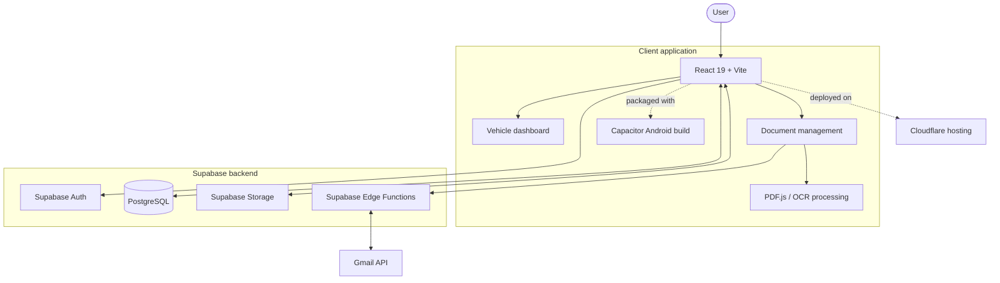

<!--
  MyGarage — Premium README
  Visual direction: Minimal Midnight / Electric Blue
  Note: Feature status is intentionally separated into implemented and planned work.
-->

  

  
  
  

  <strong>One place to manage vehicles, organize documents and simplify the responsibilities of ownership.</strong>

◈ Overview
MyGarage is a multi-vehicle management application designed to bring vehicle information and important ownership documents into one connected workspace.

The project combines a React application with Supabase services, Gmail integration and document-processing workflows. It is being developed for web use, with an Android build produced through Capacitor.

The goal is straightforward: reduce scattered records and make it easier to keep track of the information that matters for every vehicle.
▣ The bento grid
<table>
  <tr>
    <td colspan="2" width="66%" valign="top">🚘 01 / Multi-vehicle garage
Manage multiple vehicles from a centralized dashboard. Vehicle records are associated with the user's garage rather than being tied to a single hardcoded vehicle.
</td>
<td width="34%" valign="top">
☁️ 02 / Cloud foundation
Supabase provides authentication and the hosted database foundation for the application.
</td>

  </tr>
  <tr>
    <td width="33%" valign="top">📄 03 / Document management
- Document categorization
- Vehicle matching
- Duplicate detection
- Document version history
    </td>
    <td width="33%" valign="top">
📧 04 / Gmail workflow
Connect Gmail and discover PDF attachments that may contain vehicle-related documents. Attachments can be reviewed and processed through the document workflow.
</td>
<td width="34%" valign="top">
🔎 05 / PDF processing
Extract text from supported PDFs and use the extracted information to assist document classification and vehicle matching. OCR-assisted extraction is part of the processing workflow.
</td>

  </tr>
  <tr>
    <td colspan="3" valign="top">📱 06 / Web and Android
The application is built with React and Vite. Capacitor is used to package the web application for Android; an Android APK has been generated and tested.
</td>

  </tr>
</table>⚡ Technology stack
Application

  

Technology	Role
JavaScript	Main application language
JSX	React component syntax
React 19	Component-based user interface
Vite 8	Development server and build tooling
CSS	Application styling

Backend and cloud

  

Technology	Role
Supabase	Backend platform
Supabase Auth	User authentication
PostgreSQL	Relational database
Supabase Edge Functions	Server-side integration and protected operations
Supabase Storage	Cloud file storage
Cloudflare	Web deployment and hosting

Document and integration layer
Technology / service	Role
Gmail API	Discover and retrieve Gmail attachments with user authorization
Google OAuth 2.0	Gmail account authorization
PDF.js	PDF text extraction and document inspection
OCR processing	Text extraction fallback for supported scanned PDFs
Deno / TypeScript	Runtime and language used by Supabase Edge Function code

Mobile and developer tooling

  

Tool	Role
Capacitor 8	Native Android project and web-to-mobile packaging
Android	Mobile build target
Node.js and npm	JavaScript development environment and package management
Git	Version control
GitHub	Source-code hosting
Visual Studio Code	Development environment
ESLint	JavaScript code linting

◈ System architecture

Document workflow
1. The user connects a Gmail account through the authorization flow.
2. MyGarage discovers PDF attachments for review.
3. The attachment is retrieved through a protected server-side function.
4. PDF text extraction and OCR-assisted processing are used where supported.
5. Extracted information is evaluated for document type and vehicle association.
6. The user can review and manage the resulting document record.
◈ Implementation status
The project is under active development. The checklist below distinguishes working foundations from workflows that are still being improved or planned.

<strong>01 — Application foundation</strong> · COMPLETED
- [x] React + Vite application
- [x] Supabase authentication
- [x] Cloud database integration
- [x] Multi-vehicle management
- [x] Cloudflare deployment
- [x] Android APK generation and testing

<strong>02 — Document management</strong> · IMPLEMENTED / BEING IMPROVED
- [x] Document categorization
- [x] Vehicle matching
- [x] Duplicate detection
- [x] Document version history
- [x] Gmail account integration
- [x] PDF attachment discovery and retrieval workflow
- [x] PDF text extraction workflow
- [ ] Improve reliability across different PDF formats and attachment sizes
- [ ] Complete and harden automated document processing
- [ ] Improve extraction and classification accuracy

<strong>03 — Ownership automation</strong> · PLANNED
- [ ] Automated document-expiry notifications
- [ ] Proactive insurance and PUC renewal reminders
- [ ] Maintenance and service tracking
- [ ] Next-service reminders
- [ ] Expanded mobile experience
- [ ] Intelligent vehicle insights

◈ Engineering focus
MyGarage is being developed around a few practical engineering priorities:
- Multi-vehicle data handling: features should work across a user's garage, not rely on hardcoded vehicle records.
- Document reliability: PDFs can vary in structure, quality and readability, so extraction and classification need validation and graceful failure handling.
- Secure integrations: Gmail access requires explicit user authorization and protected handling of OAuth credentials.
- Incremental delivery: the application separates completed foundations from workflows that still need reliability improvements.
- Web-to-mobile delivery: the React application can be packaged for Android through Capacitor.
◈ Roadmap
Area	Next focus
Document intelligence	Improve extraction, classification and vehicle matching
Renewal management	Expiry dates, reminders and notification delivery
Maintenance	Service history, costs and next-service tracking
Mobile	Improve the Android experience
Insights	Useful summaries across the user's vehicles

◈ Local development
Prerequisites
- Node.js and npm
- A Supabase project with the required environment configuration
- Git
Run the application
# Clone the repository
git clone https://github.com/AlwinJCOde667/MyGarage.git

# Enter the project
cd MyGarage

# Install dependencies
npm install

# Start the development server
npm run dev
Available scripts
npm run dev      # Start Vite development server
npm run build    # Create a production build
npm run preview  # Preview the production build
npm run lint     # Run ESLint
Configure the required Supabase and Google OAuth settings before using authenticated and Gmail-connected features. Never commit API secrets, service-role keys, OAuth client secrets or private environment files.

◈ Built by

  <strong>Alwin John Shajan</strong>
   
  Computer Science & Engineering
    
  

  <em>Designed around a simple idea: vehicle ownership should be easier to manage.</em>

